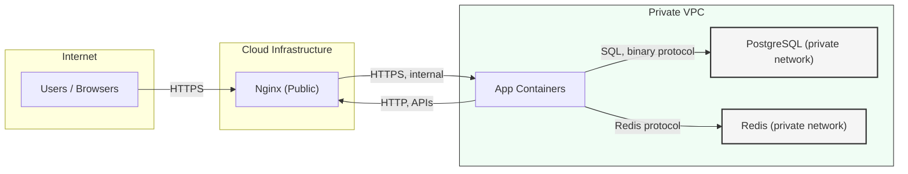
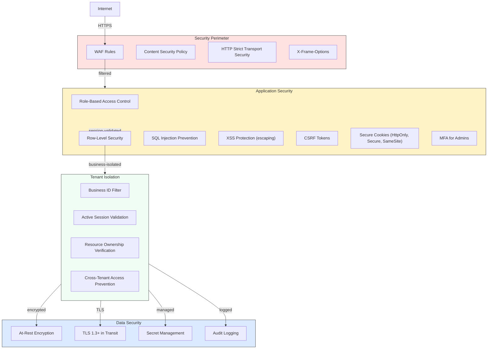
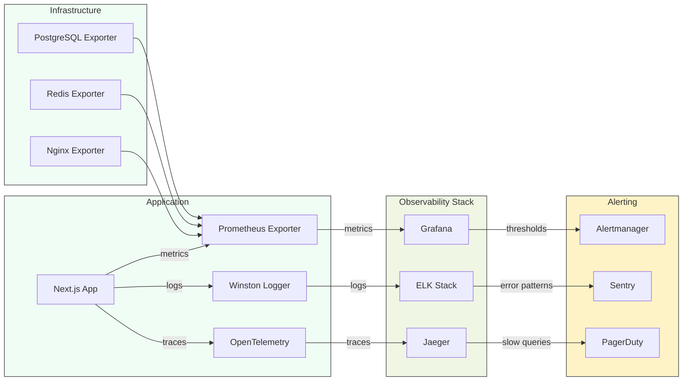

# 06. System Architecture Diagram

## 6.1 High-Level System Architecture

```mermaid
graph TD
    %% Client Layer
    subgraph Client["Client Layer"]
        U["Web Browser / Client"]
        M["Mobile Browser"]
    end
    
    %% Edge Layer
    subgraph Edge["Edge Layer"]
        NG["Nginx Reverse Proxy"]
        TL["TLS/SSL Termination"]
        WAF["Web Application Firewall"]
    end
    
    %% Application Layer
    subgraph App["Application Layer (Next.js)"]
        RC["React Components\n(App Router)"]
        SC["Server Components"]
        SA["Server Actions"]
        RH["Route Handlers"]
        TS["Shared Types/\nUtils"]
        LI["Lib Services\n(Prisma, Redis, Storage)"]
    end
    
    %% Database Layer
    subgraph DB["Database Layer"]
        PG["PostgreSQL\n(with PgBouncer)"]
    end
    
    %% Cache/Queue Layer
    subgraph Cache["Cache/Queue Layer"]
        RD["Redis\n(session + cache)"]
        MQ["BullMQ\n(background jobs)"]
    end
    
    ;; Storage Layer
    subgraph Storage["Object Storage"]
        S3["S3-Compatible\nStorage"]
    end
    
    %% External Services
    subgraph External["External Services"]
        PGW["Payment Gateway\n(optional)"] 
        RES["Resend/SMTP\n Email"] 
        FS["File Storage"]
    end
    
    %% Connections
    U -->|HTTPS| NG
    NG -->|HTTPS| RC
    NG -->|HTTPS| RH
    
    RC --> SC
    RC --> SA
    RC --> RH
    
    SC -->|reads| LI
    SC -->|writes| LI
    SA --> LI
    RH --> LI
    
    LI --> PG
    LI --> RD
    LI --> MQ
    LI --> S3
    
    MQ -->|processes| LI
    
    PG -->|audit/analysis| LI
    
    NG --> WAF
    NG --> TL
    
    LI -->|emails| RES
    LI -->|files| S3
    
    style DB fill:#f5f5f5,stroke:#333,stroke-width:2px
    style App fill:#f0fdf4,stroke:#333,stroke-width:1px
    style Edge fill:#f0fdf4,stroke:#333,stroke-width:1px
    style Cache fill:#f0fdf4,stroke:#333,stroke-width:1px
    style Storage fill:#f0fdf4,stroke:#333,stroke-width:1px
    style External fill:#eff6e4,stroke:#333,stroke-width:1px,stroke-dasharray: 5 5
```

## 6.2 Detailed Component Architecture

### 6.2.1 Next.js Application Architecture

#### 18.104.22.168 App Router Structure
- **App Router** (`app/` directory) as the primary routing mechanism
- **File-based routing**: `app/[route]/page.tsx` pattern
- **Parallel Routes**: Using `@/folder` convention for modals, sidebars
- **Intercepting Routes**: For modals and drawer navigations
- **Loading UI**: Global and route-level loading skeletons
- **Error UI**: Global error boundaries

#### 22.214.171.124 Server Components (Default)
- All pages by default are Server Components
- Data fetching at the route level
- No client-side JavaScript required for initial render
- Secure: database credentials, API keys not sent to browser
- Streaming: partial page rendering for better perceived performance

#### 126.96.36.199 Server Actions
- In-line form handlers in React components
- Auto-bound to the component's form state
- Execute in Node.js runtime with full database access
- Can directly call Prisma, Redis, storage APIs
- Must re-verify permissions (session check)
- Decorated with `use server` directive

#### 188.8.131.52 Route Handlers
- `app/api/*/route.ts` for internal APIs
- `pages/api/*` for legacy compatibility (if needed)
- Express-style middleware pattern
- Used for: webhooks, external APIs, file uploads
- Authentication via Auth.js session verification

#### 184.108.40.206 Middleware
- `middleware.ts` at root or `app/` level
- Request filtering and transformation
- Locale handling (if multi-language)
- Business session validation
- Redirects for auth checks
- Runs at Edge network (fast)

### 6.2.2 Shared Libraries

#### 6.2.21 Prisma Client
- Type-safe database queries
- Generated from Prisma schema
- Used in Server Components, Server Actions, Route Handlers
- Connection pooling via `connectionMiddleware`
- Transaction management for financial operations

```typescript
// Example usage in Server Action
import { prisma } from '@/lib/prisma';

async function createInvoice(formData: FormData) {
  const businessId = await getActiveBusinessId();
  
  return await prisma.$transaction(async (tx) => {
    // Create invoice
    const invoice = await tx.invoice.create({
      data: {
        businessId,
        number: generateInvoiceNumber(),
        status: 'UNPAID',
        totalAmount: formData.get('totalAmount') as number,
        // ... line items
      },
    });
    
    // Create journal entry
    await tx.journalEntry.create({
      data: {
        businessId,
        type: 'INVOICE_ISSUED',
        description: `Invoice #${invoice.number} issued`,
        lines: {
          create: [
            { account: 'accountsReceivable', debit: invoice.totalAmount },
            { account: 'salesRevenue', credit: invoice.totalAmount },
          ],
        },
      },
    });
    
    return invoice;
  });
}
```

#### 6.2.22 Redis Client
- Session store (Auth.js default)
- Server-side cache for frequently accessed data
- Product catalog caching (TTL-based)
- Rate limiting store
- Job tracking for BullMQ

```typescript
// Example Redis usage
import { redis } from '@/lib/redis';

// Cache product list for 5 minutes
await redis.set(
  `products:catalog:${businessId}`,
  JSON.stringify(cachedProducts),
  'EX',
  300
);

// Read from cache
const cached = await redis.get(`products:catalog:${businessId}`);
const products = cached ? JSON.parse(cached) : await prisma.product.findMany();
```

#### 6.2.23 BullMQ Worker
- Background job processing
- Email sending (transactional)
- PDF invoice generation
- Export operations (Excel, PDF)
- Image processing/optimization
- Payment webhook processing

```typescript
// Example job definition
import { Queue } from 'bullmq';

const emailQueue = new Queue('email', { connection: redisOptions });

await emailQueue.add('send-welcome', {
  userId: userId,
  template: 'welcome',
  variables: { name: userName },
});

// Worker definition
import { Worker } from 'bullmq';

new Worker(
  'email',
  async job => {
    const { template, variables } = job.data;
    // Send email using Resend or SMTP
  },
  { connection: redisOptions }
);
```

### 6.2.24 S3 Storage Integration

#### 6.2.241 Storage Structure
```
s3://b2b-marketplace/
  ├── product-images/
  │   ├── businessId/
  │   │   └── productId/
  │   │       ├── main.jpg
  │   │       ├── thumb-100x100.jpg
  │   │       ├── WebP-version.jpg
  │   │       └── metadata.json
  ├── invoices/
  │   ├── businessId/
  │   │   └── invoiceId/
  │       ├── pdf-original.pdf
  │       ├── pdf-compressed.pdf
  │       └── metadata.json
  ├── business-documents/
  │   └── businessId/
  │       ├── registration-certificate.pdf
  │       ├── license.pdf
  │       └── metadata.json
  ├── user-uploads/
  └── temp/
```

#### 6.2.242 Upload Flow
1. User selects file in UI
2. Frontend uploads to S3 via pre-signed URL (via `openart_upload_sign` or custom)
3. Backend verifies upload via `openart_upload_metadata_get`
4. File referenced by `visualReference` (key + bucket)
5. URL generation for display (presigned, time-limited or CORS-enabled)

#### 6.2.243 Download/Access Flow
1. Application generates pre-signed URL (valid 24h)
2. Browser accesses file via URL
3. S3 logs access for audit
4. CORS configured for browser direct access (where appropriate)
5. Private bucket, no public read access

### 6.2.25 Email Service

#### 6.2.251 Transactional Email Providers
- **Resend**: API-based, modern, good deliverability
- **SMTP**: Fallback, self-hosted or third-party (SendGrid, Mailgun)
- **Templates**: Handlebars or EJS for HTML emails

#### 6.2.252 Email Events
- Welcome email (on registration)
- Email verification link
- Password reset link
- Invoice generated notification
- Payment received notification
- Order status update
- Quotation received notification
- Weekly summary/digest
- Overdue payment reminder

```typescript
// Example email sending via Resend
import { Resend } from 'resend';

const resend = new Resend(process.env.RESEND_API_KEY);

await resend.emails.send({
  from: 'platform@b2b-marketplace.com',
  to: user.email,
  subject: 'Your quotation has been received',
  react: QuotationReceivedEmail({ quotation, wholesalerName }),
});
```

### 6.2.26 Background Job Processing Flow

```mermaid
graph LR
    subgraph UI["User Interface"]
        A["Submit form"] -->|HTTP Request| B(Next.js App)
    end
    
    B -->|prisma.create+queue.add| C[Database Transaction]
    B -->|BullMQ.add| D[Job Queue (Redis)]
    
    C -->|commit| E[Prisma Tables]
    D -->|process| F[BullMQ Worker]
    
    F -->|process| G[Background Task]
    G -->|send email| H[SMTP/Resend]
    G -->|generate PDF| I[PDF Library]
    G -->|export Excel| J[Excel Library]
    G -->|optimize image| K[Image Processing]
    
    H -->|email sent| L[Email Received]
    I -->|PDF generated| M[PDF File]
    J -->|Excel generated| N[Excel File]
    K -->|optimized image| O[Image File]
    
    M -->|save to S3| P[S3 Storage]
    O -->|save to S3| P[S3 Storage]
    
    L -->|user notified| A
    M -->|notification| A
    N -->|notification| A
    O -->|notification| A
    
    style C fill:#DBEAFE,stroke:#333,stroke-width:1px
    style D fill:#DBEAFE,stroke:#333,stroke-width:1px
    style F fill:#DBEAFE,stroke:#333,stroke-width:1px
```

## 6.3 Deployment Architecture

### 6.3.1 Docker Compose Services

```yaml
version: '3.8'

services:
  # Application
  app:
    build: ./docker/app
    ports: ["3000:3000"]
    environment:
      - NODE_ENV=production
      - DATABASE_URL=postgres://...
      - REDIS_URL=redis://redis:6379
      - S3_BUCKET=...
      - RESend_API_KEY=...
    depends_on:
      - postgres
      - redis
    env_file: .env.production
    restart: unless-stopped
    healthcheck:
      test: ["CMD", "curl", "-f", "http://localhost:3000/health"]
      interval: 30s
      timeout: 10s
      retries: 3

  # Database
  postgres:
    image: postgres:15-alpine
    environment:
      - POSTGRES_USER=b2b_user
      - POSTGRES_PASSWORD=${POSTGRES_PASSWORD}
      - POSTGRES_DB=b2b_platform
    volumes:
      - postgres_data:/var/lib/postgresql/data
      - ./docker/init:/docker-entrypoint-initdb.d
    ports: ["5432:5432"]
    restart: unless-stopped
    healthcheck:
      test: ["CMD", "pg_isready", "-U", "b2b_user", "-d", "b2b_platform"]
      interval: 10s
      timeout: 5s
      retries: 5

  # Cache/Queue
  redis:
    image: redis:7-alpine
    command: ["redis-server", "--maxmemory", "256mb", "--maxmemory-policy allkeys-lru"]
    volumes:
      - redis_data:/data
    ports: ["6379:6379"]
    restart: unless-stopped
    healthcheck:
      test: ["CMD", "redis-cli", "ping"]
      interval: 10s
      timeout: 5s
      retries: 3

  # Reverse proxy
  nginx:
    image: nginx:alpine
    ports: ["80:80", "443:443"]
    volumes:
      - ./docker/nginx/nginx.conf:/etc/nginx/nginx.conf:ro
      - ./docker/nginx/certs:/etc/nginx/certs:ro
      - ./dist:/usr/share/nginx/html:ro
    restart: unless-stopped
    healthcheck:
      test: ["CMD", "wget", "--spider", "-q", "http://localhost/health"]
      interval: 30s
      timeout: 10s
      retries: 3
```

### 6.3.2 Network Architecture



### 6.3.3 Environment Configuration

| Variable | Description | Required |
|----------|-------------|--------|
| `DATABASE_URL` | PostgreSQL connection string | Yes |
| `POSTGRES_PRISMA_URL` | Prisma-specific connection | Yes |
| `DIRECT_URL` | Direct connection (migrations only) | Yes (admin) |
| `REDIS_URL` | Redis connection | Yes |
| `SESSION_SECRET` | Auth.js session signing | Yes |
| `NEXTAUTH_URL` | NextAuth callback URL | Yes |
| `NEXTAUTH_SECRET` | NextAuth session secret | Yes |
| `S3_BUCKET` | S3 bucket name | Yes |
| `S3_REGION` | S3 region | Yes |
| `S3_ACCESS_KEY_ID` | S3 access key | Yes |
| `S3_SECRET_ACCESS_KEY` | S3 secret key | Yes |
| `RESEND_API_KEY` | Resend email API key | Yes |
| `ENCRYPTION_KEY` | For sensitive data encryption | Yes |
| `JWT_SECRET` | JWT signing secret | Yes |
| `RATE_LIMIT_WINDOW_MS` | Rate limit window | No (default: 60000) |
| `RATE_LIMIT_MAX` | Rate limit max requests | No (default: 100) |

### 6.3.4 Secrets Management
- Never commit `.env` files
- Use GitHub Actions secrets for CI/CD
- Docker secrets or `docker-compose.override.env`
- Production: use cloud secret manager (AWS Secrets Manager, HashiCorp Vault)
- Rotation: rotate secrets quarterly or on compromise
- `.env.example` (no values) committed for team reference

## 6.4 Data Flow Diagrams

### 6.4.1 Product Creation Flow
```
User Action → Server Action → Zod Validation → Prisma Transaction → S3 Upload → Redis Cache Invalidate → Revalidate → Response
```

### 6.4.2 Order Creation Flow (Multi-Seller)
```
User Adds to Cart → Cart contains items from multiple sellers → Checkout → Split by seller → For each seller:
  → Prisma transaction: validate stock → reserve stock → create order → create invoice → release payment
→ Aggregate order summary → Client receives confirmation → Email notifications → Background jobs
```

### 6.4.3 Payment Webhook Flow
```
Gateway → POST /api/payments/webhook → Verify signature → Idempotency check → Prisma transaction → Update payment status → Trigger journal entry → Redis cache invalidate → Notify user → Response to gateway
```

### 6.4.4 Invoice Generation Flow
```
User Requests Invoice → Server Action → Prisma: check invoice exists → Generate PDF (React PDF or wkhtmltopdf) → Save to S3 → Return PDF URL → Email notification → Cache update
```

## 6.5 Security Architecture



## 6.6 Monitoring and Observability



## 6.7 Disaster Recovery

### 6.7.1 Backup Strategy
- **PostgreSQL**: Daily full backup, point-in-time recovery (PITR)
- **Retention**: 30 days automatic, 90 days on request
- **Storage**: Separate bucket/volume from production
- **Testing**: Restore test monthly

### 6.7.2 Recovery Time Objective (RTO)
- Target: 4 hours maximum for full system restore
- Critical data restore: 1 hour
- Non-critical feature degradation: immediate

### 6.7.3 Recovery Point Objective (RPO)
- Target: maximum 24 hours data loss acceptable
- Preferred: < 1 hour data loss (incremental backups)
- Financial data: < 15 minutes (write-ahead logging)

### 6.7.4 Failover Capabilities
- Nginx can redirect to standby instance
- Redis replication for session continuity
- Database failover with patroni or similar (future)
- Read-only mode if write fails