# 07. Business Workflow Diagrams

## 7.1 User Registration and Onboarding Workflow

```mermaid
graph TD
    subgraph Registration["Registration Workflow"]
        A[User navigates to /register] --> B[Select role: Wholesaler/Client]
        B --> C[Enter email, password, business name]
        C --> D[Submit registration form]
        D -->|Async| E[Auth.js creates user account]
        E --> F[Send email verification link]
        F --> G[User clicks verification link]
        G -->|Verified| H[Account created, redirect to onboarding]
        G -->|Failed| I[Show error, resend verification]
        
        H --> J[Select business type: WHOLESALER/CLIENT]
        J --> K[Create business profile]
        K --> L[Upload business documents (optional)]
        L --> M[Business verification tracking]
        M --> N[Verification status: PENDING_VERIFICATION]
        N --> O[Features accessible at PENDING level]
        O --> P[User can complete profile later]
    end
    
    style Registration fill:#eff6e4,stroke:#333,stroke-width:1px
```

## 7.2 Product Enquiry and Quotation Workflow

```mermaid
graph TD
    subgraph EnquiryQuotation["Enquiry & Quotation Workflow"]
        %% Client side
        C1[Client browses products] --> C2[Select product(s), click "Send Enquiry"]</br>C2 -->|Navigate to| C3[Fill enquiry form: product, quantity, specs]
        C3 --> C4[Submit enquiry]
        C4 -->|Create| E1[Enquiry record created]
        E1 -->|Notify| E2[Wholesaler receives enquiry notification]
        
        %% Wholesaler side
        W1[Wholesaler receives enquiry] --> W2[View enquiry details]
        W2 --> W3[Respond to enquiry]
        W3 -->|Navigate to| W4[Fill quotation form: price, quantity, MOQ, terms]
        W4 --> W5[Send quotation to client]
        W5 -->|Create| Q1[Quotation record created]
        Q1 -->|Set validity| Q2[Validity date set (e.g., 30 days)]
        Q2 -->|Notify| Q3[Client receives quotation]
        
        %% Client response
        C5[Client receives quotation] --> C6[View quotation details]
        C6 --> C7[Options: Accept / Reject / Request Revision]
        C7a[Accept] -->|Navigate to| C8[Confirm quantities, accept terms]
        C8 --> C9[Accept quotation]
        C9 -->|Create| O1[Order created from quotation]
        O1 -->|Stock reserved| O2[Stock reservation confirmed]
        O2 -->|Invoice created| O3[Seller invoice generated]
        O3 -->|Payment processed| O4[Payment recorded]
        
        C7b[Reject] -->|Create| R1[Quotation marked rejected]
        R1 -->|Preserve| H1[History maintained for records]
        
        C7c[Request Revision] -->|Navigate to| W6[Wholesaler modifies quotation]
        W6 -->|New quotation| Q4[Revised quotation created]
        Q4 -->|Set new validity| Q5[New validity date]
        Q5 -->|Notify| Q6[Client notified of revision]
    end
    
    style EnquiryQuotation fill:#f0fdf4,stroke:#333,stroke-width:1px
```

## 7.3 Multi-Seller Checkout Workflow

```mermaid
graph TD
    subgraph MultiSellerCheckout["Multi-Seller Checkout Workflow"]
        A[Client cart contains items from:] -->|Wholesaler A| B1[Rs. 15,000]</br>Wholesaler B| B2[Rs. 25,000]</br>Wholesaler C| B3[Rs. 10,000]
        
        A --> C[Client proceeds to checkout]
        C --> D[Split cart by seller]
        
        D -->|Order Group 1| B1_1[Order for Wholesaler A: Rs. 15,000]</br>Invoice A</br>Shipment A</br>Payment gateway A</br>
        D -->|Order Group 2| B2_1[Order for Wholesaler B: Rs. 25,000]</br>Invoice B</br>Shipment B</br>Payment gateway B</br>
        D -->|Order Group 3| B3_1[Order for Wholesaler C: Rs. 10,000]</br>Invoice C</br>Shipment C</br>Payment gateway C</br>
        
        B1_1 -->|Client sees| E[Aggregated summary: Rs. 50,000 total]</br>3 separate seller orders]
        B2_1 -->|Client sees| 
        B3_1 -->|
        
        %% Per-seller processing
        B1_1 --> F1[Prisma transaction: validate stock A → reserve stock A]
        B2_1 --> F2[Prisma transaction: validate stock B → reserve stock B]
        B3_1 --> F3[Prisma transaction: validate stock C → reserve stock C]
        
        F1 --> G1[Order A created, status: PENDING]
        F2 --> G2[Order B created, status: PENDING]
        F3 --> G3[Order C created, status: PENDING]
        
        G1 --> H1[Invoice A generated, status: UNPAID]
        G2 --> H2[Invoice B generated, status: UNPAID]
        G3 --> H3[Invoice C generated, status: UNPAID]
        
        H1 --> I1[Client pays Invoice A (online/manual/credit)]
        H2 --> I2[Client pays Invoice B]
        H3 --> I3[Client pays Invoice C]
        
        I1 --> J1[Payment recorded, Invoice A: PAID</br>Order A: move to PROCESSING]
        I2 --> J2[Payment recorded, Invoice B: PAID</br>Order B: move to PROCESSING]
        I3 --> J3[Payment recorded, Invoice C: PAID</br>Order C: move to PROCESSING]
        
        J1 --> K1[Wholesaler A ships, Order A: DISPATCHED]
        J2 --> K2[Wholesaler B ships, Order B: DISPATCHED]
        J3 --> K3[Wholesaler C ships, Order C: DISPATCHED]
    end
    
    style MultiSellerCheckout fill:#f0fdf4,stroke:#333,stroke-width:1px
```

## 7.4 Order Lifecycle Workflow (Single Seller)

```mermaid
graph TD
    subgraph OrderLifecycle["Order Lifecycle Workflow"]
        A1[New order created] -->|Status| A2[PENDING]
        A2 -->|Wholesaler accepts| A3[ACCEPTED]
        A3 -->|Warehouse prepares| A4[PROCESSING]
        A4 -->|Items ready| A5[READY FOR DISPATCH]
        A5 -->|Dispatch recorded| A6[DISPATCHED]
        A6 -->|In transit| A7[DELIVERED]
        A7 -->|Completion| A8[COMPLETED]
        
        %% Cancel path
        A2 -->|Client cancels (eligible)| A9[CANCELLED]</br>Stock released
        A3 -->|Client cancels (eligible)| A9[CANCELLED]</br>Stock released
        A4 -->|Client cancels (eligible)| A9[CANCELLED]</br>Stock released
        
        %% Return path
        A8 -->|Return requested| A10[RETURN REQUESTED]
        A10 -->|Return approved| A11[RETURN IN PROGRESS]
        A11 -->|Items received| A12[RETURNED]
        A12 -->|Refund processed| A13[REFUNDED</br>Payment reversed]
        A12 -->|No fault| A14[EXCHANGED</br>New order created]
        
        %% Payment states tied to order
        P1[Invoice: UNPAID] -->|Payment received| P2[Invoice: PARTIALLY_PAID]
        P2 -->|Full payment| P3[Invoice: PAID]
        P3 -->|Refund issued| P4[Invoice: REFUNDED]
        
        A9 -->|Restock| A2[Back to PENDING with restocked inventory]
    end
    
    style OrderLifecycle fill:#eff6e4,stroke:#333,stroke-width:1px
```

## 7.5 Invoice and Payment Workflow (Online Payment)

```mermaid
graph TD
    subgraph InvoicePaymentOnline["Invoice & Online Payment Workflow"]
        A1[Invoice created] --> A2[Invoice: UNPAID, due date set]
        A2 -->|Client pays via gateway| B1[POST /api/payments]
        B1 -->|Validate idempotency key| B2[Check: same key exists?]
        B2 -->|Yes| B3[Return cached payment record]
        B2 -->|No| C1[Prisma transaction]
        
        C1 -->|Create payment record| C2[Payment: PENDING]
        C1 -->|Verify gateway signature| C3[Validate webhook payload]
        C3 -->|Valid| C4[Update payment: COMPLETED]
        C3 -->|Invalid| C5[Payment: FAILED</br>Log error]
        
        C4 -->|Update invoice status| D1[Invoice: PARTIALLY_PAID if partial</br>PAID if full]
        C4 -->|Trigger journal entry| E1[Create journal: Accounts Receivable → Sales Revenue]
        C4 -->|Redis invalidate| F1[Clear invoice cache]
        C4 -->|Send notification| G1[Email: Payment received]
        
        D1 -->|Invoice fully paid| H1[Invoice: PAID</br>Order: move to next status]
        D1 -->|Invoice partially paid| H2[Invoice: PARTIALLY_PAID</br>Reminder sent]
        
        C5 -->|Handle failure| I1[Invoice: still UNPAID</br>Retry later</br>Send failure notice]
        
        %% Webhook retry
        I1 -->|Retry webhook after delay| B1[Re-enter payment workflow]
        
        %% Overdue monitoring
        H1 -->|Past due date| J1[Invoice: OVERDUE</br>Auto-reminder schedule]
        J1 -->|Still unpaid after N days| K1[Mark overdue, apply credit terms if configured]
        K1 -->|Manual review| L1[Admin/wholesaler marks follow-up]
    end
    
    style InvoicePaymentOnline fill:#f0fdf4,stroke:#333,stroke-width:1px
```



## 7.6 Manual Payment Workflow

```mermaid
graph TD
    subgraph InvoicePaymentManual["Invoice & Manual Payment Workflow"]
        A1[Invoice created, status: UNPAID] --> A2[Due date set]
        
        A2 --> B1[Client views invoice]
        B1 --> B2[Client submits payment info]
        B2 -->|Upload proof of payment| B3[Upload proof document]
        B3 -->|Validate| B4[Proof verified by wholesaler]
        B4 -->|Mark as paid| C1[Wholesaler records payment]
        C1 -->|Update status| C2[Invoice: PAID</br>or PARTIALLY_PAID]
        C2 -->|Trigger journal entry| D1[Create journal entry same as online]
        C2 -->|Send notification| E1[Email: Payment recorded</br>Invoice updated]
        
        C2 -->|Partial payment| C3[Invoice: PARTIALLY_PAID</br]Outstanding balance shown]
        C3 -->|Remaining balance paid later| C4[Repeat manual payment flow]
        C4 -->|Full settlement| C5[Invoice: PAID</br>Order progresses]
        
        %% Overdue tracking
        A2 -->|Past due date| F1[Invoice: OVERDUE]
        F1 --> G1[Reminder email sent (day 1, 3, 7, 14)]
        F1 -->|N days overdue| H1[Credit check: wholesaler reviews client limit]
        H1 -->|Within credit limit| I1[Continue normal operations]
        H1 -->|Over credit limit| J1[Suspend future orders</br>or require partial advance]
        
        %% Payment search
        G1 -->|Client pays after reminder| C2[Back to payment recording]
    end
    
    style InvoicePaymentManual fill:#eff6e4,stroke:#333,stroke-width:1px
```

## 7.7 Credit Terms Workflow

```mermaid
graph TD
    subgraph CreditTerms["Credit Terms Workflow"]
        A1[Client approved for credit] --> A2[Credit limit configured: Rs. 100,000]
        A2 --> A3[Payment terms: Net 30 days]
        A3 --> A4[Due date calculated per invoice]
        A4 --> A5[Outstanding balance tracked]
        
        A5 --> B1[New invoice created, adds to outstanding]
        A5 --> B2[Payment received, reduces outstanding]
        A5 --> B3[Overdue monitoring active]
        
        B1 --> C1[Outstanding balance: Rs. 45,000 (new invoice Rs. 30,000 + previous Rs. 15,000)]
        B1 --> C2[Credit utilization: 45% of limit]
        
        B2 --> C3[Payment allocated: Rs. 20,000 applied to oldest invoice first]
        C3 --> C4[Outstanding: Rs. 25,000</br]Utilization: 25%]
        
        B3 --> D1[Invoice overdue by 15 days]
        D1 --> D2[Gentle reminder email]
        D1 -->|Overdue > 30 days| D3[Stronger reminder + phone call]
        D1 -->|Overdue > 60 days| D4[Credit review: reduce limit or require COD]
        D1 -->|Overdue > 90 days| D5[Debt collection consideration</br>or suspend credit]
        
        B3 --> E1[Journal entry: Accounts Receivable → Cash]
        B2 --> E2[Journal entry: Cash → Accounts Receivable]
        
        %% Credit limit enforcement
        C4 --> F1[Client attempts new order]
        F1 --> F2[Check: outstanding + new order ≤ credit limit?]
        F2 -->|Yes| F3[Order allowed, normal process]
        F2 -->|No| F4[Options:)</br>• Pay partial advance</br>• Reduce order quantity</br>• Wait for payment</br>• Apply for limit increase]
        
        F4 --> G1[Client chooses option]
        G1 -->|Pay partial| F3[Back to allowed]
        G1 -->|Reduce quantity| F3[Back to allowed]
        G1 -->|Wait| F3[After payment processes]
        G1 -->|Request increase| H1[Admin reviews</br>approves/rejects]
    end
    
    style CreditTerms fill:#f0fdf4,stroke:#333,stroke-width:1px
```

## 7.8 Returns and Refunds Workflow

```mermaid
graph TD
    subgraph ReturnsRefunds["Returns & Refunds Workflow"]
        A1[Client receives order] --> A2[Inspect order quality]
        A2 -->|Defective/Wrong item| B1[Request return]
        A2 -->|No issue| B2[No return needed]
        B2 -->|Within wear period| C1[Request exchange]
        
        B1 --> C2[Submit return request form]
        C2 -->|Wholesaler approves| C3[Return request created]
        C3 -->|Reject (ineligible)| C4[Notify client: reason</br>no return eligibility]
        C3 -->|Approve| C5[Provide return shipping label/address]
        
        C5 --> D1[Client ships items back]
        D1 -->|Items received by wholesaler| E1[Inspect received items]
        E1 -->|Accept| E2[Process refund]
        E1 -->|Reject (damaged further)| E3[Notify client</br>return rejected]
        
        E2 --> F1[Create refund record]
        F1 --> G1[Process payment refund]
        G1 --> H1[Update invoice: REFUNDED]
        G1 --> I1[Reverse journal entry]
        G1 --> J1[Send refund confirmation email]
        
        E2 -->|Partial refund| F2[Partial refund recorded]
        F2 --> G2[Partial invoice update]
        F2 --> H2[Partial journal entry]
        
        %% Exchange workflow
        C1 -->|Exchange processed| K1[Create new order]
        K1 --> L1[Ship replacement items]
        K1 --> M1[Original order: CANCELLED</br>refund not applicable]
        
        style ReturnsRefunds fill:#f0fdf4,stroke:#333,stroke-width:1px
    end
```

## 7.9 Business Suspension and Reactivation Workflow

```mermaid
graph TD
    subgraph Suspension["Business Suspension/Reactivation"]
        A1[Reason for suspension: overdue payments, policy violation, request]
        A2[Super admin or wholesaler-initiated]
        
        A2 -->|Super admin initiates| B1[Review case: audit log check]
        B1 -->|Valid reason| B2[Suspend business]
        B1 -->|Invalid| B3[Reject suspension</br>notify requestor]
        
        B2 --> C1[Business status: SUSPENDED]
        C1 --> C2[Login restricted: limited features only]
        C2 --> C3[New orders blocked]
        C3 --> C4[Existing orders: still completable if eligible]
        C4 --> C5[Invoices: payment still due</br>but services limited]
        C5 --> C6[Notifications: suspension alert sent]
        C6 --> D1[Business can reactivate]
        
        %% Reactivation
        D1 -->|Super admin reactivates| E1[Business status: ACTIVE]
        E1 -->|Self-service reactivation (if reason resolved)| F1[Apply reactivation</br>fees/conditions]
        F1 --> G1[Business reactivated</br>full access restored]
        
        %% Wholesaler-initiated
        H1[Wholesaler suspends own business] --> I1[Same flow as above]
        I1 --> I2[Business suspended</br>own dashboard access limited]
        
        %% Employee access during suspension
        C2 --> I3[Role-based access during suspension:]
        I3 --> I4[OWNER: view data, reactivate, contact support</br>MANAGER: limited view only</br>ACCOUNTANT: view invoices/payments only</br>SALES/INVENTORY/VIEWER: access denied]
        
        style Suspension fill:#fff7e5,stroke:#333,stroke-width:1px
    end
```

## 7.10 User Business Membership Management

```mermaid
graph TD
    subgraph MembershipManagement["User Business Membership Management"]
        A1[User logs in] --> A2[Auth.js session validated]
        A2 --> A3[Resolve active business memberships]
        A3 -->|Single membership| A4[Auto-select business, redirect]
        A3 -->|Multiple memberships| B1[Show business selector UI]
        B3 -->|No membership| B2[Onboard: create/join business]
        
        B1 --> C1[Select business from list]
        C1 --> C2[Business membership set as active]
        C2 --> C3[Dashboard reflects selected business]
        C3 --> C4[All actions filtered by active business]
        
        C4 --> D1[User can switch businesses (if allowed)]
        D1 -->|Switch| D2[New business selected as active]
        D2 --> D3[Session updated</br>all queries re-filtered]
        
        D3 --> E1[Permissions re-checked for new business]
        E1 -->|Role valid for new business| E2[Normal operation continues]
        E1 -->|Role not valid| E3[Redirect to appropriate dashboard]
        
        %% Invite workflow
        F1[OWNER invites another user] --> F2[Enter user email]
        F2 --> F3[Invitation sent via email]
        F3 --> F4[Invitee clicks invitation link]
        F4 -->|Registers/Logs in| F5[New user created / existing user added]
        F5 --> F6[User assigned default role (typically VIEWER or SALES)]
        F6 --> F7[User sees business in their list]
        F7 --> F8[Can switch to that business selector]
        
        %% Permission assignment
        G1[OWNER/MANAGER assigns role] --> G2[Select user from business member list]
        G2 --> G3[Choose role: OWNER/MANAGER/ACCOUNTANT/SALES/INVENTORY/VIEWER]
        G3 --> G4[Role assigned, access updated immediately]
        G4 --> G5[Audit log: role assignment recorded]
        G5 --> G6[User sees updated dashboard]
    end
    
    style MembershipManagement fill:#f0fdf4,stroke:#333,stroke-width:1px
```