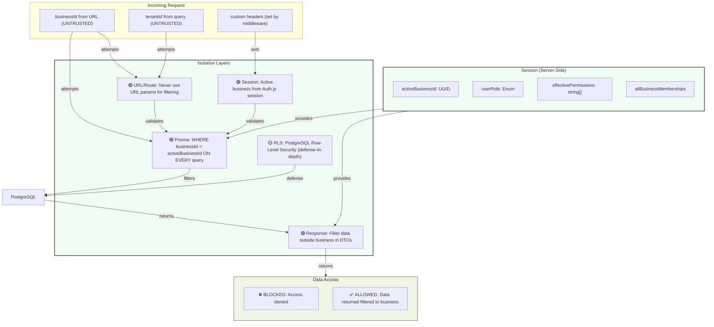

# 14. Tenant Isolation Architecture

## 14.1 Core Principle: Shared Database with Strict Isolation

The platform uses a **single PostgreSQL database** with all businesses sharing the same schema, but each business's data is strictly isolated at every layer. No separate database per tenant (cost-effective at scale, but requires rigorous isolation).

## 14.2 Tenant Isolation Layers

### 14.2.1 URL/Route Layer
- **Never trust** `businessId` or `tenantId` from URL parameters or query strings
- Active business resolved exclusively from **server-side session**
- Dynamic route segments (`/[businessId]`) used only for UI navigation, not for data filtering
- Middleware validates session business matches route parameter (if present)

```typescript
// ❌ WRONG: Using businessId from URL for data filtering
const products = await prisma.product.findMany({
  where: { businessId: req.params.businessId }, // VULNERABLE
});

// ✅ CORRECT: Resolving from active session
const activeBusiness = await getActiveBusinessFromSession(req);
const products = await prisma.product.findMany({
  where: { businessId: activeBusiness.id }, // SECURE
});
```

### 14.2.2 Session Layer
- **Auth.js** manages sessions with business membership embedded
- Session structure includes `activeBusinessId` and `userRole`
- Session refreshed on each request if near expiry (15-min warning)
- Maximum 3 concurrent sessions per user (configurable)
- Session invalidated on:
  - Password change
  - Business suspension
  - Role change
  - Manual logout
  - Token revocation

### 14.2.3 Business Membership Layer
```typescript
interface UserSession {
  id: string;
  email: string;
  name?: string;
  businesses: BusinessMembership[]; // All active memberships
  activeBusinessId: string; // Currently selected/primary
  activeBusinessType: 'WHOLESALER' | 'CLIENT';
  role: 'OWNER' | 'MANAGER' | 'ACCOUNTANT' | 'SALES' | 'INVENTORY' | 'VIEWER';
  permissions: string[]; // Effective permissions for active business
}
```

- User can belong to **multiple businesses** (separated by role per business)
- Business selector UI when user has multiple memberships
- Default business = first active membership or last selected
- Switching businesses updates session and re-filters all queries

### 14.2.4 Prisma Query Layer (Primary Isolation)
**Every Prisma query includes a business filter**:

```typescript
// Base query pattern applied in service layer or middleware
const withBusinessFilter = (qb) => {
  return qb.where({ businessId: activeBusiness.id });
};

// Usage in repositories
const products = await prisma.product.findMany(
  withBusinessFilter(prisma.product.findMany())
);

// Or using middleware/chain pattern
const productService = new ProductService(prisma, activeBusiness.id);
const products = await productService.list();
```

### 14.2.5 Row-Level Security (RLS) Layer
**PostgreSQL RLS as defense-in-depth** (not as primary isolation):

```sql
-- Enable RLS on key tables
ALTER TABLE products ENABLE ROW-LEVEL SECURITY;
ALTER TABLE orders ENABLE ROW-LEVEL SECURITY;
ALTER TABLE invoices ENABLE ROW-LEVEL SECURITY;
ALTER TABLE payments ENABLE ROW-LEVEL SECURITY;
ALTER TABLE inventory ENABLE ROW-LEVEL SECURITY;

-- Create policy: users can only access their business's data
CREATE POLICY business_isolation ON products
  USING (business_id = current_setting('app.business_id')::uuid);
  
-- Set the context at connection time via PgBouncer/Prisma
SET app.business_id = 'business-uuid-here';
```

**RLS Limitations with Prisma Connection Pooling**:
- RLS policies evaluated at query execution time
- Prisma client connections need `session_role` or `SET` per connection
- Connection pooling (PgBouncer) requires transaction-scoped context setting
- Recommended: Apply business filter in Prisma WHERE clause AND RLS for defense
- **Do not rely on RLS alone** - Prisma WHERE filter is primary mechanism

### 14.2.6 Response Layer
- **Response data filtered** to exclude anything outside user's business
- **Never return** `businessId` in responses unless explicitly needed (and even then, only the user's business ID)
- **Audit log** every data access attempt
- **Automated filtering** via response middleware or DTO transformation

```typescript
// Example: Product response DTO filters out wholesaler-internal fields
const productResponse = {
  id: product.id,
  name: product.name,
  slug: product.slug,
  images: product.images,
  // costPrice intentionally excluded from client API
  // visibleOnly: true fields included
  b2bSellingPrice: product.b2bSellingPrice,
  mrp: product.mrp,
};
```

### 14.2.7 Key Isolation Rules (Never Break These)

| # | Rule | Reason |
|---|------|--------|
| 1 | **Never trust `businessId` from browser** | Client could modify URL/query param to access other businesses |
| 2 | **Resolve active business from server session** | Session is server-side, tamper-resistant |
| 3 | **Validate membership for every request** | Each request independently verified |
| 4 | **Verify ownership for every resource operation** | Ensure resource belongs to user's business |
| 5 | **Apply tenant filters to every database query** | Prisma WHERE clause on every query |
| 6 | **Prevent cross-business access** on: products, inventory, orders, invoices, payments, ledger | Core business rule |
| 7 | **Use database foreign-key constraints** | Enforce referential integrity at DB level |
| 8 | **Evaluate PostgreSQL RLS as defense-in-depth** | Additional layer if Prisma filter fails |
| 9 | **Maintain audit logs for sensitive operations** | Forensics, compliance, breach investigation |
| 10 | **Session expiry re-verification** | Refresh on each page load/interaction |

### 14.2.8 Middleware Implementation

```typescript
// nextjs/middleware.ts
import { NextResponse } from 'next/server';
import type { NextRequest } from 'next/navigation';
import { getActiveBusinessFromSession } from '@/lib/auth';

export async function middleware(request: NextRequest) {
  const path = request.nextUrl.pathname;
  
  // Public paths - skip business validation
  if (path.startsWith('/auth') || path === '/' || path === '/marketplace') {
    return NextResponse.next();
  }
  
  // Get session
  const session = await auth();
  if (!session?.user?.businesses?.length) {
    // No business membership - redirect to onboarding
    return NextResponse.redirect(new URL('/b2b/onboard', request.url));
  }
  
  // Get active business from session
  const activeBusiness = await getActiveBusinessFromSession(session);
  if (!activeBusiness) {
    return NextResponse.redirect(new URL('/b2b/onboard', request.url));
  }
  
  // Attach business context to request headers for downstream use
  const response = NextResponse.next();
  response.headers.set('x-business-id', activeBusiness.id);
  response.headers.set('x-business-type', activeBusiness.type);
  response.headers.set('x-user-role', session.role);
  
  return response;
}

export const config = {
  matcher: [
    '/b2b/:path*',
    '/marketplace/:path*',
    '/admin/:path*',
    '/((?!auth|_next|api|_vercel).*),
  ],
};
```

### 14.2.9 Prisma Connection Pool + RLS Setup

```typescript
// prisma/middleware.ts or connection setup
import { PrismaClient } from '@prisma/client';

const prisma = new PrismaClient({
  // Connection pooling config
  connectionPooler: true,
});

// Per-request business context setup (in middleware or interceptor)
async function withBusinessContext<T>(businessId: string, fn: () => Promise<T>): Promise<T> {
  // Set RLS policy context at connection level
  await prisma.$executeRaw`SET app.business_id = ${businessId}`;
  
  try {
    return await fn();
  } finally {
    // Clear context after request
    await prisma.$executeRaw`SET app.business_id = NULL`;
  }
}
```

**Important**: With Prisma's connection pooling, the `SET` command must be issued per-transaction or per-query, not just once per connection. Consider using:
- `$executeRaw` for the SET command before each query
- Or Prisma's `queryRaw` wrapper
- Or application-level WHERE clause (recommended as primary)

### 14.2.10 Cross-Business Access Prevention Checklist

**Pre-development verification**:
- [ ] All API routes begin with `verifyBusinessMembership()` 
- [ ] All Server Actions check `getActiveBusiness()` 
- [ ] No raw SQL queries without business filter
- [ ] Prisma schema has no direct businessId exposure
- [ ] Integration tests verify cross-business access is blocked
- [ ] Penetration testing includes IDOR attempts
- [ ] Code review confirms no business filter bypasses
- [ ] RLS policies tested with pooler connections
- [ ] Audit logs capture all cross-business access attempts (even failed)
- [ ] Documentation updated with isolation rules

## 14.3 Tenant Isolation Diagrams



## 14.4 Business Identifier Strategy

### 14.4.1 UUID Primary Keys
- All `businessId` fields use `UUID` type
- Generated via `gen_random_uuid()` in PostgreSQL or `uuidv4()` in application
- Never sequential or guessable numbers
- Format: `xxxxxxxx-xxxx-4xxx-yxxx-xxxxxxxxxxxx` (RFC 4122)

### 14.4.2 Business ID in URLs
- **Not** exposed in public URLs for data access
- May appear in dynamic routing for UI navigation
- Always resolved from session, not used as query filter
- Example: `/b2b/wholesaler` route - business resolved from session, not URL param

### 14.4.3 Business ID in Headers
- `x-business-id` header set by middleware
- Downstream services read from header
- Provides defense-in-depth if request bypasses middleware

## 14.5 Tenant Isolation Test Strategy

### 14.5.1 Unit Tests
- Verify Prisma queries always include business filter
- Test service methods reject when wrong business context
- Validate response DTOs filter correctly

### 14.5.2 Integration Tests
- **Cross-business product access**: Wholesaler A cannot list/ view Wholesaler B's products
- **Cross-business order access**: Client A cannot view Client B's orders
- **Cross-business invoice access**: Wholesaler A cannot access Wholesaler B's invoices
- **Cross-business payment access**: Payment records isolated per business
- **Cross-business ledger access**: Ledger accounts per business only
- **Enquiry/Quotation isolation**: Enquiries only between specific client/wholesaler pair

### 14.5.3 End-to-End Tests
- Register two businesses, verify data separation
- Create products under one, verify other cannot see
- Create order under one, verify other cannot access
- Attempt IDOR via URL manipulation, verify blocked
- Switch business membership, verify data re-filters
- Suspend business, verify all access restricted

### 14.5.4 Security Tests
- Penetration testing for IDOR vulnerabilities
- Attempt access via modified businessId in URL
- Test session fixation resistance
- Test concurrent business membership switching
- Test RLS bypass attempts