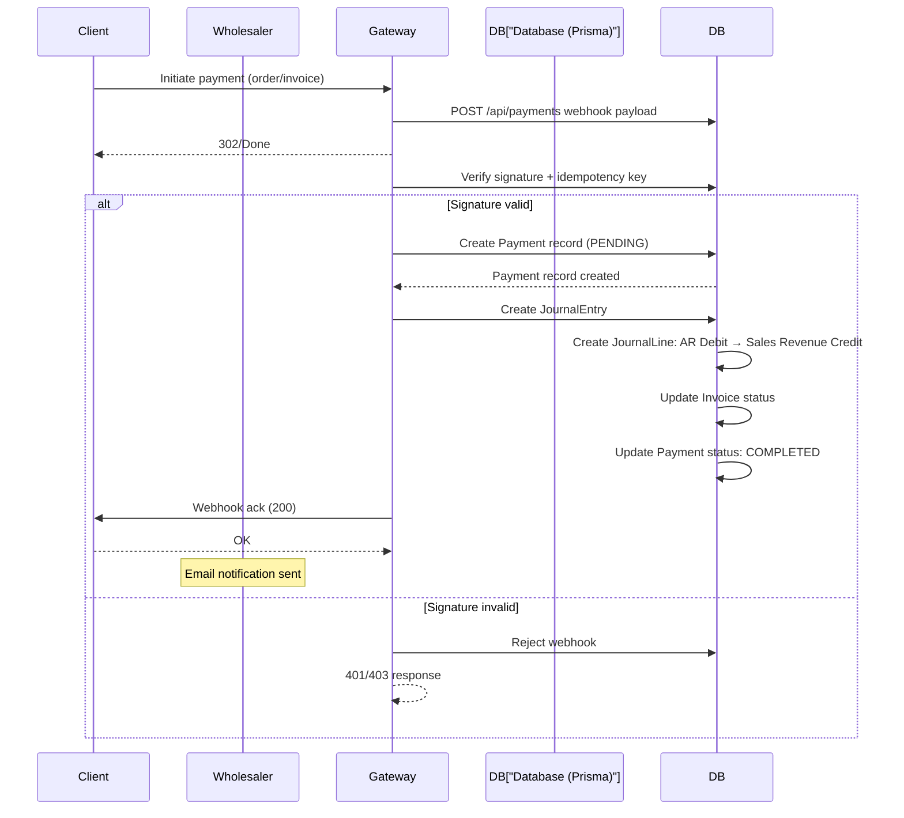
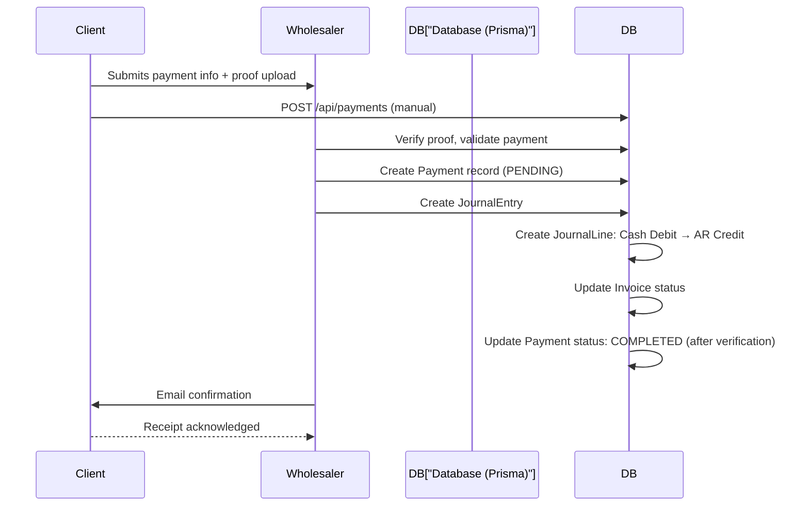
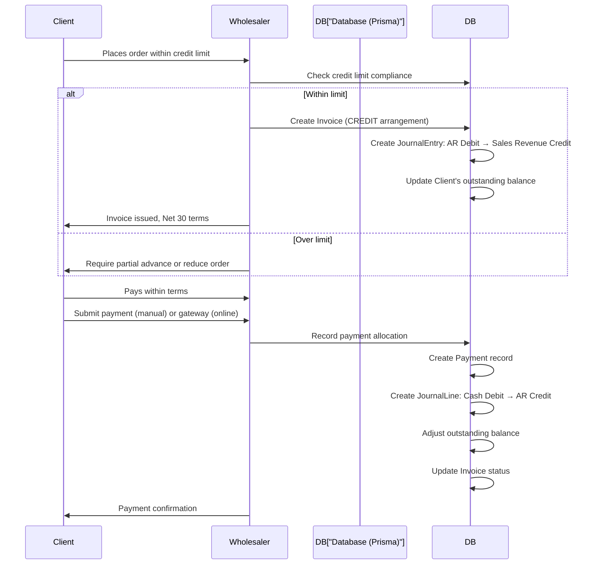
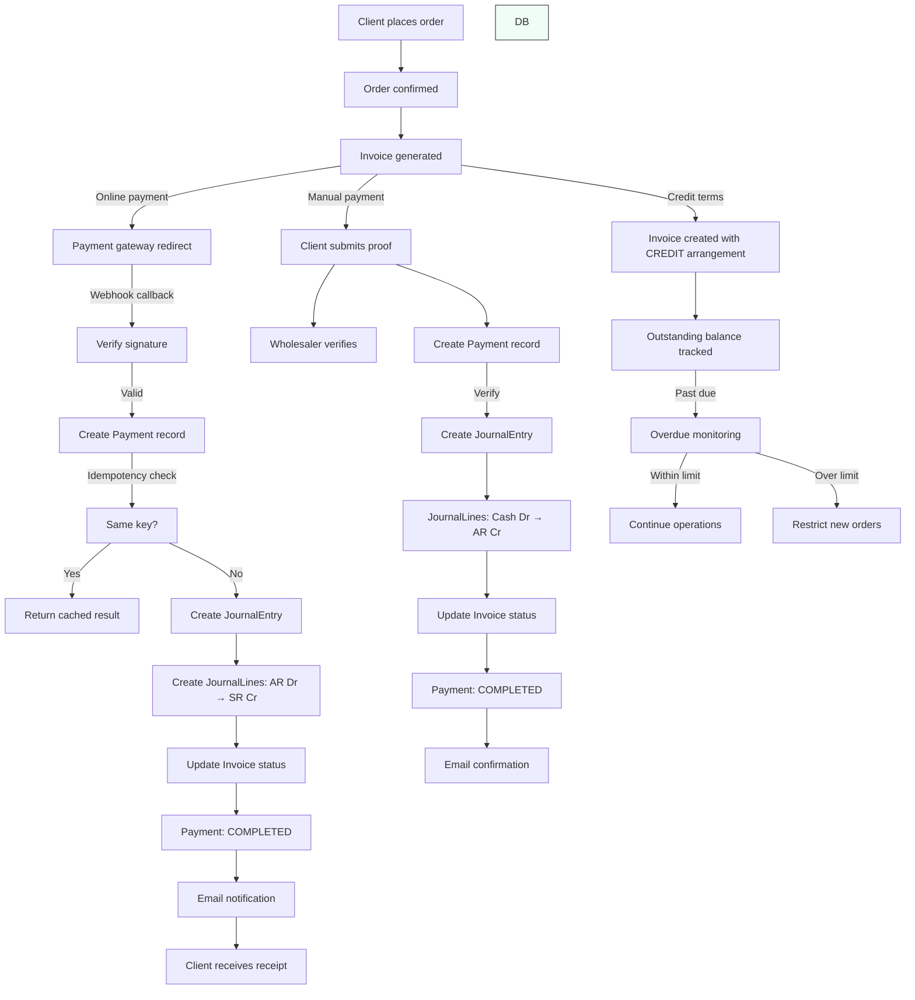
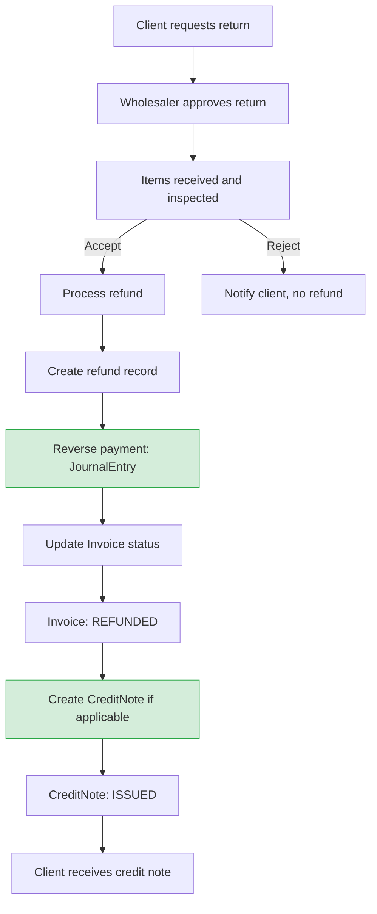

# 16. Financial and Accounting Architecture

## 16.1 Core Principle: Double-Entry Accounting

The platform uses **double-entry accounting** where every financial transaction affects at least two accounts: a debit and a credit. Total debits must always equal total credits.

**Key Principle**: Never implement the ledger as a manually editable balance column. Use journal entries to record transactions, and calculate balances from those entries.

## 16.2 Accounting Entities

### 16.2.1 LedgerAccount

Each business maintains its own chart of accounts.

**Wholesaler Accounts**:
| Account Name | Code | Type | Subtype | Description |
|-------------|------|------|---------|-------------|
| Accounts Receivable | AR | Asset | Receivable | Money owed by clients |
| Bank | BA | Asset | Cash | Bank account balance |
| Cash | CA | Asset | Cash | Cash on hand |
| Sales Revenue | RE | Revenue | Operating | Income from sales |
| Sales Returns | RE | Revenue | Contra | Returns of sold goods |
| Tax Payable | TL | Liability | Tax | Output tax collected |
| Inventory | AS | Asset | Stock | Raw materials/finished goods |
| Cost of Goods Sold | EX | Expense | Production | Direct production costs |

**Client Accounts**:
| Account Name | Code | Type | Subtype | Description |
|-------------|------|------|---------|-------------|
| Accounts Payable | AP | Liability | Payable | Money owed to suppliers |
| Bank | BA | Asset | Cash | Bank account balance |
| Cash | CA | Asset | Cash | Cash on hand |
| Purchases | EX | Expense | Operating | Goods purchased |
| Purchase Returns | EX | Expense | Contra | Returns of purchased goods |
| Input Tax | TL | Tax | Input | Tax paid on purchases |
| Inventory/Asset | AS | Asset | Inventory | Purchased goods |

**Common Accounts (both)**:
| Account Name | Code | Type | Description |
|-------------|------|------|-------------|
| Sales Discounts | EX | Expense | discounts given |
| Purchase Discounts | EX | Expense | discounts received |
| Operating Expenses | EX | Expense | rent, utilities, etc |
| Payroll Expenses | EX | Expense | employee salaries |
| Exchange Gain/Loss | EX | Expense | currency fluctuation |

### 16.2.2 JournalEntry

```typescript
interface JournalEntry {
  id: UUID;
  businessId: UUID; // The business this entry belongs to
  entryDate: Date; // Transaction date
  description: string; // Human-readable description
  referenceType: 'INVOICE' | 'PAYMENT' | 'CREDIT_NOTE' | 'ADJUSTMENT' | 'REVERSAL';
  referenceId: UUID; // The invoices/payments/creditNotes involved
  status: 'POSTED' | 'REVERSED' | 'DRAFT';
  createdAt: DateTime;
  createdByUserId: UUID; // Who posted this entry
}
```

### 16.2.3 JournalLine

Each journal entry has multiple lines that must balance:

```typescript
interface JournalLine {
  id: UUID;
  journalEntryId: UUID;
  accountId: UUID; // FK to LedgerAccount
  debit: Decimal(12,2); // Debit amount (0 if credit)
  credit: Decimal(12,2); // Credit amount (0 if debit)
  description: string; // Optional line description
  sortOrder: integer; // Ordering within entry
}
```

**Balance Rule**: For each journal entry, `SUM(debits) = SUM(credits)`.

### 16.2.4 Payment

```typescript
interface Payment {
  id: UUID;
  businessIdPayer: UUID; // Client business who paid
  sellerBusinessId: UUID; // Wholesaler business who received
  invoiceId: UUID; // Optional - which invoice this pays
  orderId: UUID; // Optional - which order this relates to
  amount: Decimal(12,2); // Amount paid
  currency: string; // Usually NPR
  paymentArrangement: 'ONLINE' | 'MANUAL' | 'CREDIT';
  status: 'PENDING' | 'COMPLETED' | 'FAILED' | 'REFUNDED' | 'PARTIALLY_APPLIED';
  gatewayReference: string; // Payment gateway transaction ID
  proofUrl: string; // For manual payments: proof upload URL
  verifiedAt: DateTime; // When wholesaler verified
  verifiedByBusinessId: UUID; // The wholesaler business
  verifiedByUserId: UUID; // The specific user who verified
  idempotencyKey: string; // For duplicate prevention
  transactionId: string; // Unique transaction identifier
  createdAt: DateTime;
  updatedAt: DateTime;
}
```

### 16.2.5 PaymentAllocation

When a payment covers multiple invoices:

```typescript
interface PaymentAllocation {
  id: UUID;
  paymentId: UUID; // The payment record
  invoiceId: UUID; // Which invoice this allocation is for
  amountAllocated: Decimal(12,2); // Amount from payment applied to this invoice
  remainingPaymentAmount: Decimal(12,2); // Still unused from this payment
  allocationOrder: integer; // Sequence: 1, 2, 3... (oldest invoice first typically)
  createdAt: DateTime;
}
```

### 16.2.6 Invoice

```typescript
interface Invoice {
  id: UUID;
  sellerBusinessId: UUID; // Wholesaler issuing invoice
  clientBusinessId: UUID; // Client receiving invoice
  invoiceNumber: string; // Unique seller-specific numbering
  fiscalYear: string; // Format: "FY2024" or "FY{year}"
  status: 'UNPAID' | 'PARTIALLY_PAID' | 'PAID' | 'OVERDUE' | 'CANCELLED' | 'CREATED';
  discountAmount: Decimal(10,2); // Discount applied
  taxAmount: Decimal(10,2); // Tax calculated
  deliveryCharges: Decimal(10,2); // Delivery/charges
  totalAmount: Decimal(12,2); // Grand total
  currency: string; // Usually NPR
  dueDate: Date; // Payment due date
  issuedAt: DateTime; // When created
  paidAt: DateTime; // When fully paid
  cancelledAt: DateTime; // When cancelled
  
  // Calculated/derived (not stored, computed from line items + payments)
  outstandingBalance: Decimal; // totalAmount - sum of allocations
}
```

### 16.2.7 InvoiceItem

```typescript
interface InvoiceItem {
  id: UUID;
  invoiceId: UUID;
  productVariantSnapshot: JSON; // Snapshot at time of invoicing
  quantity: integer;
  unitPrice: Decimal(10,2); // Price at invoice time
  discount: Decimal; // Percentage 0-100
  totalPrice: Decimal(12,2); // unitPrice × quantity × (1 - discount/100)
  taxRate: Decimal(5,2); // e.g., 13.00 for 13%
  taxAmount: Decimal(12,2); // calculated tax on subtotal
}
```

### 16.2.8 CreditNote

```typescript
interface CreditNote {
  id: UUID;
  businessIdIssuer: UUID; // Wholesaler issuing credit
  clientBusinessId: UUID; // Client receiving credit
  referenceInvoiceId: UUID; // Original invoice being corrected
  creditNoteNumber: string; // Unique per issuer
  reason: 'RETURN' | 'DISCOUNT' | 'CORRECTION' | 'GOODWILL';
  amount: Decimal(12,2); // Credit amount
  status: 'ISSUED' | 'APPLIED' | 'EXPIRED';
  validUntil: DateTime; // When credit expires (if applicable)
  appliedAt: DateTime; // When applied to invoice
  issuedAt: DateTime;
  notes: string; // Reason details
  
  // Effect: reduces amount client owes; increases wholesale's receivable adjustment
}
```

## 16.3 Accounting Workflows

### 16.3.1 Invoice Payment Processing (Online)



### 16.3.2 Invoice Payment Processing (Manual)



### 16.3.3 Credit Payment Workflow



### 16.3.4 Journal Entry Creation Rules

**Every posted journal entry must balance**:
```
Total debits = Total credits
```

**Example: Invoice Issued**
```
DR: Accounts Receivable        $50,000
CR: Sales Revenue               $50,000
```

**Example: Customer Payment**
```
DR: Cash / Bank                 $30,000
CR: Accounts Receivable         $30,000
```

**Example: Partial Payment (Rs. 20k on Rs. 50k invoice)**
```
DR: Accounts Receivable         $20,000
CR: Cash / Bank                   $20,000
```
*(Remaining Rs. 30k still outstanding)*

**Example: Credit Note (Rs. 5k return)**
```
DR: Sales Returns               $5,000
CR: Accounts Receivable         $5,000
```
*(Or: DR: AR, CR: Revenue depending on accounting policy)*

**Reversal Entry** (for corrections):
```
DR: Original account (reversed)
CR: Original account (reversed with opposite sign)
New entry posted with CORRECTION type
```

### 16.3.5 Fiscal Period Management

**Fiscal Period**:
- Typically follows Nepal fiscal year (July 1 - June 30) or calendar year
- Configurable per business
- Periods can be: Open, Closed, Locked
- Closed periods: new entries restricted, reports frozen
- Locked periods: no changes allowed, audit-ready

**Example Fiscal Periods**:
```
FY2024: 2024-07-01 to 2025-06-30 (Nepal fiscal)
FY2024-Calendar: 2024-01-01 to 2024-12-31
```

**Period Closing**:
1. Review all entries for period
2. Generate trial balance
3. Confirm all invoices settled or identified as outstanding
4. Mark period as "Closed" - new entries discouraged but possible with adjustment
5. Mark period as "Locked" - no changes without SUPER_ADMIN approval

### 16.3.6 Report Generation

**Trial Balance Report**:
```
Ledger Account                    Debit      Credit
---------------------------------------------------
Accounts Receivable                $45,000         $0
Accounts Payable                    $0        $30,000
Sales Revenue                       $0        $75,000
Cost of Goods Sold               $40,000         $0
Bank                             $15,000         $0
---------------------------------------------------
TOTAL                             $100,000      $100,000
```

**Aged Receivables/Payables**:
- Bucket by due date: Current, 1-30 days, 31-60 days, 61-90 days, 90+ days
- Priority collection for > 90 days
- Configurable buckets per business

**Profit and Loss**:
- Revenue: Sales total - Returns - Discounts
- Gross Profit: Revenue - COGS
- Operating Expenses: Sum of expense accounts
- Net Profit: Gross Profit - Operating Expenses

**Balance Sheet**:
- Assets: Cash + Bank + AR + Inventory
- Liabilities: AP + Tax Payable + Other liabilities
- Equity: Opening balance + Net Profit/Loss

## 16.4 Decimal Precision and Calculations

### 16.4.1 Money Storage
- All monetary values stored as `Decimal(12, 2)` in PostgreSQL
- Represented in smallest unit (paisa) OR in rupees with 2 decimal places
- **Never** use floating-point (float, real) for monetary values
- JavaScript: Use `BigInt` or `decimal.js` for calculations; avoid `Number` for money

### 16.4.2 Rounding Rules
- **Display rounding**: `ROUND_HALF_UP` (standard mathematical rounding)
- **Database storage**: Full precision maintained, rounded only for display
- **Calculation precision**: Full precision throughout calculation chain
- **Final display**: Rounded to 2 decimal places at output

### 16.4.3 Example Calculations

**Subtotal with discount**:
```
unitPrice: 1250.50
quantity: 3
discount: 10 (percent)
subtotal = 1250.50 × 3 = 3751.50
discountAmount = 3751.50 × 10/100 = 375.15
subtotalAfterDiscount = 3751.50 - 375.15 = 3376.35
```

**Tax calculation** (assuming 13% VAT):
```
subtotalAfterDiscount: 3376.35
taxAmount = 3376.35 × 13/100 = 438.93 (rounded to 2dp)
total = 3376.35 + 438.93 = 3815.28
```

**Payment allocation** (Rs. 5,000 allocated across 3 invoices: Rs. 2,000 + Rs. 2,500 + Rs. 500):
```
Invoice 1: Rs. 2,000 allocated → remaining: Rs. 3,000 outstanding
Invoice 2: Rs. 2,500 allocated → remaining: Rs. 1,500 outstanding
Invoice 3: Rs. 500 allocated → remaining: Rs. 950 outstanding (partial)
Remaining from payment: Rs. 0 (fully allocated)
```

## 16.5 Financial Workflow Diagrams

### 16.5.1 End-to-End Payment Flow with Accounting



### 16.5.2 Credit Limit Enforcement

```mermaid
flowchart TD
    A[Client attempts new order] --> B[Calculate: current outstanding + new order total]
    B -->|Within credit limit| C[Allow order, normal process]
    B -->|Exceeds credit limit| D[Present options:]
    D -->|Pay partial advance| E[Client pays portion]</br>C[Allow reduced order]
    D -->|Reduce quantity| F[Client reduces order size]</br>C[Allow]
    D -->|Wait for payment| G[Client pays down balance first]</br>C[Allow]
    D -->|Request limit increase| H[Admin reviews request]</br>I[Approve/reject]
    
    style C fill:#d4edda,stroke:#28a745
    style D fill:#fff3cd,stroke:#ffc107
```

### 16.5.3 Refund and Credit Note Flow

