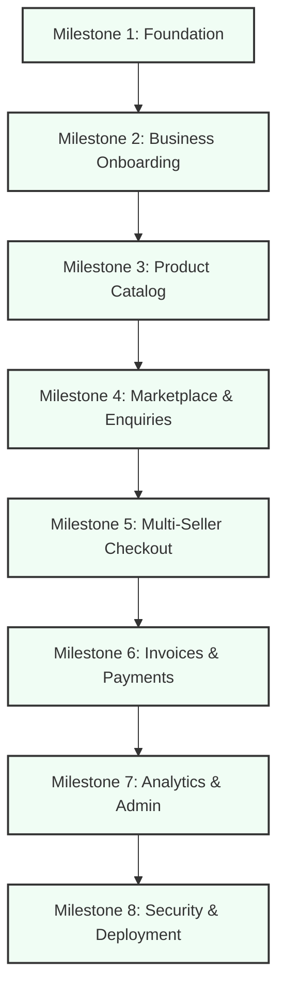

# 20. Development Roadmap

## 20.1 Milestone Overview

The implementation is divided into 8 milestones, each with specific scope, dependencies, deliverables, and acceptance criteria.

---

## 20.2 Milestone 1: Foundation

### Scope
- Project setup and configuration
- Docker infrastructure (PostgreSQL, Redis, Next.js app)
- Prisma ORM setup and schema
- Auth.js authentication (email/password, sessions)
- Business membership and RBAC foundation
- Tenant isolation middleware and infrastructure
- Basic project structure and conventions

### Dependencies
- None (foundational)

### Deliverables
- Docker Compose with all services (app, postgres, redis)
- Prisma schema with core tables (User, Business, BusinessMembership, Session, VerificationToken)
- Auth.js configuration with email/password provider
- Middleware for business session validation
- TypeScript configurations and base types
- ESLint/Prettier configurations
- Git setup with conventional commits

### Database Changes
- Initial Prisma migration creating core identity and business tables

### API Requirements
- `/api/auth/*` endpoints (register, login, verify, reset)
- `/api/businesses/*` basic CRUD
- `/api/memberships/*` invite/join management

### UI Requirements
- Basic layout structure (app shell)
- Authentication pages (login, register, verify, reset)
- Protected route skeleton

### Security Requirements
- Secure password hashing (Argon2id via Auth.js)
- Email verification flow
- Session management with HttpOnly cookies
- Rate limiting on auth endpoints
- Basic audit log setup

### Acceptance Criteria
- [ ] Docker compose brings up all services (app, postgres, redis)
- [ ] Prisma schema migrates successfully
- [ ] User can register with business type selection
- [ ] User can login/logout
- [ ] Email verification sends and works
- [ ] Active business resolved from session
- [ ] Cross-business access blocked at middleware level
- [ ] Rate limiting active on auth endpoints

### Testing Requirements
- Unit tests for auth flow
- Integration tests for business creation/isolation
- E2E test: complete registration flow

### Risks
- Prisma schema design may need iteration based on actual needs
- Auth.js configuration may require provider-specific adjustments
- Docker network configuration may need tweaking for local development

---

## 20.3 Milestone 2: Business Registration and Verification

### Scope
- Business onboarding flow
- Business profile creation (Wholesaler/Client)
- Business verification status tracking
- Employee management under businesses
- Role assignment and permissions

### Dependencies
- Milestone 1 (authentication, business membership tables)

### Deliverables
- Business registration Server Action/Route
- Business type selection (WHOLESALER/CLIENT)
- WholesalerProfile and ClientProfile models/CRUD
- Business verification status management (UNVERIFIED → PENDING → VERIFIED/REJECTED/SUSPENDED)
- Business member invitation and role assignment
- Role-permission enforcement

### Database Changes
- Add WholesalerProfile, ClientProfile tables
- Update BusinessMembership with role field
- Add verificationStatus to Business
- Add indexes for frequently queried fields

### API Requirements
- `POST /api/businesses` (create business during onboarding)
- `POST /api/memberships/invite` (invite user to business)
- `POST /api/memberships/accept` (accept invitation)
- `GET /api/me` (return user with businesses and roles)
- `PATCH /api/businesses/[id]` (update business info)
- Business verification endpoints (admin)

### UI Requirements
- Onboarding flow: role selection → business name → profile completion
- Business dashboard selector (when user has multiple businesses)
- Profile edit pages for wholesaler/client types
- Role assignment UI (OWNER only, or MANAGER depending)

### Security Requirements
- Business ownership verification on all operations
- Invitation token validation
- Role assignment permission checks (OWNER only)

### Acceptance Criteria
- [ ] User can register and select wholesaler/client type
- [ ] Business profile created with correct type
- [ ] User invited to business and assigned role
- [ ] Business verification status tracked and observable
- [ ] OWNER can assign roles to other members
- [ ] Non-OWNER cannot assign roles
- [ ] Business type determines accessible features

### Testing Requirements
- Unit tests for business creation and role assignment
- Integration tests for invitation flow
- E2E test: register as wholesaler, invite team member
- Isolation tests: Wholesaler A's data invisible to Wholesaler B

### Risks
- Role hierarchy complexity may require refinement
- Business type feature gating needs careful implementation
- Invitation flow edge cases (expired tokens, duplicate emails)

---

## 20.4 Milestone 3: Product Catalog and Variants

### Scope
- Product creation and management
- Product variants (size/color combinations)
- Category and subcategory management
- Product imaging and media
- Basic inventory tracking setup

### Dependencies
- Milestone 2 (business membership, authentication)

### Deliverables
- Product CRUD Server Actions and API routes
- Product variant creation with SKU, size, color, pricing
- Category tree management (parent/child categories)
- Product image upload and management (S3 integration)
- Product search and filtering (basic)
- Inventory initialization per variant

### Database Changes
- Add Product, ProductVariant, ProductImage tables
- Update Category table with self-referencing parentId
- Add Inventory table linked to ProductVariant
- Add indexes on product search fields

### API Requirements
- `GET /api/v1/products` (list with filters, pagination)
- `POST /api/v1/products` (create product)
- `GET /api/v1/products/[id]` (get product detail)
- `PATCH /api/v1/products/[id]` (update product)
- `POST /api/v1/products/[id]/archive` (archive product)
- `GET /api/v1/products/[id]/variants` (list variants)
- `POST /api/v1/variants` (create variant)

### UI Requirements
- Product list page with filtering and pagination
- Product detail page (wholesaler and client views differ)
- Product form with tabs (basic info, variants, images)
- Variant inline table editor
- Image upload drag-and-drop

### Security Requirements
- Product ownership verification (business filter on all queries)
- Cost price never visible in client APIs
- MOQ and bulk pricing visible only to appropriate roles

### Acceptance Criteria
- [ ] Wholesaler can create product with variants
- [ ] Product appears in marketplace (if eligible)
- [ ] Client can view product details (MRP visible, B2B price requires auth)
- [ ] Product archived products hidden from active lists
- [ ] Variant stock tracked independently
- [ ] Search and filters work correctly
- [ ] Cost price excluded from client responses

### Testing Requirements
- Unit tests for product pricing calculations
- Integration tests for product CRUD
- Tenant isolation tests: Wholesaler A product invisible to Wholesaler B
- E2E test: wholesaler creates product, views in dashboard

### Risks
- Variant-inventory coupling may need careful transaction handling
- Product image S3 integration may have edge cases
- Search functionality may require external service (Algolia) later

---

## 20.5 Milestone 4: Marketplace and Enquiries

### Scope
- Multi-wholesaler product browsing
- Product search and filtering
- Product detail page with seller info
- Product enquiry submission
- Enquiry message thread
- Quotation response from wholesalers

### Dependencies
- Milestone 3 (products, variants, basic inventory)

### Deliverables
- Marketplace product listing page
- Advanced search and filtering (category, price, MOQ, stock)
- Product detail page (authenticated client view)
- Enquiry creation form and submission
- Enquiry message thread UI
- Wholesaler quotation response
- Quotation validity tracking
- Quotation acceptance/rejection

### Database Changes
- Enquiry, EnquiryItem, EnquiryMessage tables
- Quotation, QuotationItem, QuotationRevision tables
- Indexes for enquiry/quotation filtering

### API Requirements
- `GET /api/v1/marketplace/products` (browse with filters)
- `GET /api/v1/marketplace/products/[id]` (detail with seller info)
- `POST /api/v1/enquiries` (create enquiry)
- `GET /api/v1/enquiries` (list client's enquiries)
- `GET /api/v1/enquiries/[id]` (detail with messages)
- `POST /api/v1/enquiries/[id]/messages` (send message)
- `POST /api/v1/quotations` (create quotation response)
- `GET /api/v1/quotations` (list quotations)
- `GET /api/v1/quotations/[id]` (detail)
- `PATCH /api/v1/quotations/[id]/accept` (accept quotation)
- `PATCH /api/v1/quotations/[id]/reject` (reject quotation)

### UI Requirements
- Product grid with category/price/filters
- Product detail page with wholesale pricing CTA
- Send enquiry modal/form
- Enquiry message thread view
- Quotation detail page with accept/reject
- Validity countdown timer on quotation

### Security Requirements
- Enquiry/quotation scoped to specific client-wholesaler pair
- Quotation validity enforced (past due = expired)
- Client can only accept/reject their own quotations

### Acceptance Criteria
- [ ] Client can browse products from multiple wholesalers
- [ ] Filtering works across all wholesalers
- [ ] Client can send enquiry to wholesaler
- [ ] Wholesaler receives and can respond to enquiry
- [ ] Quotation has validity date enforcement
- [ ] Client can accept quotation, proceed to checkout
- [ ] Client can reject quotation

### Testing Requirements
- Unit tests for enquiry/quotation logic
- Integration tests for end-to-end enquiry flow
- Tenant isolation: Enquiry A-B only visible to A and B
- E2E test: client enquiry → wholesaler response → acceptance → order

### Risks
- Multi-seller enquiry handling complexity
- Quotation revision tracking may need careful design
- Validity date enforcement across timezones

---

## 20.6 Milestone 5: Multi-Seller Checkout and Orders

### Scope
- Shopping cart with multi-seller grouping
- Checkout splitting by seller
- Order creation from quotation or direct
- Order status lifecycle management
- Per-seller invoice generation
- Stock reservation and release

### Dependencies
- Milestone 4 (enquiries, quotations, products, variants)

### Deliverables
- Shopping cart CRUD (add/remove/update items)
- Cart item seller grouping display
- Checkout flow with split order warning
- Order creation (from quotation or direct purchase)
- Order status lifecycle (PENDING → ACCEPTED → PROCESSING → READY → DISPATCHED → DELIVERED → COMPLETED)
- Per-seller order items and invoices
- Stock reservation on order confirmation
- Stock release on order cancellation

### Database Changes
- Cart, CartItem tables
- Order, OrderItem, OrderStatusHistory tables
- Shipment table
- Invoice table (seller-specific numbering)
- Payment table with payment arrangement types

### API Requirements
- `GET /api/v1/cart` (get current cart)
- `POST /api/v1/cart/items` (add item)
- `PATCH /api/v1/cart/items/[id]` (update quantity)
- `DELETE /api/v1/cart/items/[id]` (remove item)
- `POST /api/v1/orders` (create order, split by seller)
- `GET /api/v1/orders` (list orders for business)
- `GET /api/v1/orders/[id]` (order detail)
- `PATCH /api/v1/orders/[id]/status` (update status)
- `POST /api/v1/orders/[id]/cancel` (cancel order)
- `GET /api/v1/orders/[id]/shipment` (shipment detail)
- `POST /api/v1/shipments` (create shipment)

### UI Requirements
- Cart page with seller grouping and split warning
- Checkout page with aggregated total
- Order list with status filters
- Order detail page with status tracker
- Shipment tracking page
- Status transition buttons (valid next states only)

### Security Requirements
- Cart belongs to client business only
- Order creation validates stock availability
- Status transitions validate role and business ownership
- Stock reservation tied to order, released on cancel

### Acceptance Criteria
- [ ] Cart can contain items from multiple sellers
- [ ] Checkout shows aggregated total + split warning
- [ ] Order created with correct seller grouping
- [ ] Each seller gets separate order/invoice
- [ ] Stock reserved on order confirmation
- [ ] Stock released on order cancellation
- [ ] Order status progresses through lifecycle
- [ ] Client can track order status

### Testing Requirements
- Unit tests for cart operations and stock calculation
- Integration tests for checkout and order creation
- Tenant isolation: Client A's order invisible to Client B
- E2E test: multi-seller checkout → separate orders → payments → delivery
- Financial tests: invoice totals balance, payment allocation

### Risks
- Stock reservation/deallocation atomicity critical
- Multi-seller order splitting logic complexity
- Order-cancellation-and-restock edge cases

---

## 20.7 Milestone 6: Invoices, Payments, and Accounting

### Scope
- Invoice generation (seller-specific)
- Three payment arrangements: online, manual, credit
- Payment recording and allocation
- Accounts receivable/payable tracking
- Ledger and journal entries
- Credit notes and refunds
- Financial reports and exports

### Dependencies
- Milestone 5 (orders, products, inventory, basic cart)

### Deliverables
- Invoice creation Server Action (from order or manual)
- Invoice item management
- PDF invoice generation
- Online payment recording (webhook handling)
- Manual payment recording with proof upload
- Payment allocation across multiple invoices
- Credit note creation and application
- Outstanding balance calculation
- Accounts receivable aging report
- Accounts payable aging report
- Trial balance report
- Excel/CSV export for financial data

### Database Changes
- Invoice, InvoiceItem tables
- Payment, PaymentAllocation tables
- CreditNote table
- LedgerAccount, JournalEntry, JournalLine tables
- FiscalPeriod table

### API Requirements
- `GET /api/v1/invoices` (list invoices)
- `POST /api/v1/invoices` (create invoice)
- `GET /api/v1/invoices/[id]` (invoice detail)
- `GET /api/v1/invoices/[id]/pdf` (generate PDF)
- `POST /api/v1/payments` (record payment)
- `POST /api/v1/payments/[id]/allocate` (allocate to invoices)
- `GET /api/v1/ledger/accounts` (list accounts)
- `POST /api/v1/ledger/accounts` (create account)
- `GET /api/v1/ledger/entries` (journal entries)
- `POST /api/v1/ledger/entries` (create journal entry)
- `GET /api/v1/ledger/balance` (account balance)
- `GET /api/v1/reports/trial-balance` (trial balance)
- `GET /api/v1/reports/ receivables` (A/R aging)
- `GET /api/v1/reports/payables` (A/P aging)
- `GET /api/v1/invoices/overdue` (overdue invoices)

### UI Requirements
- Invoice list with status filters
- Invoice detail page with line items
- PDF download button
- Payment recording form (online/manual tabs)
- Allocate payment to invoices UI
- Credit note issuance form
- Ledger/balance display
- Financial reports with date range picker
- Export to CSV/Excel buttons

### Security Requirements
- Invoice ownership (seller business)
- Payment recording requires proper authorization
- Journal entries must balance (enforced by service logic)
- Credit notes cannot increase amounts owed
- Financial data only accessible to appropriate roles (OWNER, ACCOUNTANT)

### Acceptance Criteria
- [ ] Invoice generated from order with correct line items
- [ ] Invoice has unique seller-specific numbering
- [ ] PDF generates and downloads correctly
- [ ] Online payment recorded with gateway simulation
- [ ] Manual payment recorded with proof validation
- [ ] Payment allocation across multiple invoices works
- [ ] Outstanding balance calculated correctly
- [ ] Credit note reduces outstanding balance
- [ ] A/R and A/P reports generate correctly
- [ ] Trial balance: debits = credits

### Testing Requirements
- Unit tests for all financial calculations
- Integration tests for invoice→payment→ledger flow
- Journal entry balance verification (100% of entries)
- Payment allocation edge cases (partial, multiple invoices)
- Tenant isolation: Wholesaler A's invoices invisible to Wholesaler B
- E2E test: create order → invoice → payment → ledger update
- Financial tests: precision, rounding, balance consistency

### Risks
- Double-entry accounting correctness critical
- Payment webhook idempotency must be perfect
- Journal entry balance enforcement requires careful coding
- Credit note and refund reconciliation complexity

---

## 20.8 Milestone 7: Analytics, Reports, and Admin

### Scope
- Admin dashboard with platform-wide stats
- Wholesaler dashboard with business metrics
- Client dashboard with purchase analytics
- Recharts-based charts and graphs
- Export functionality (CSV, Excel)
- Notifications and system alerts

### Dependencies
- Milestone 6 (invoices, payments, ledger, orders)

### Deliverables
- Admin dashboard overview (key stats cards)
- Business moderation panel
- Wholesaler dashboard cards and charts
- Client dashboard cards and charts
- Recharts-based visualizations:
  - Sales trends (line charts)
  - Top products (bar charts)
  - Inventory status (donut charts)
  - Payment method distribution (pie charts)
  - Monthly purchase analytics (area charts)
- Notification system (in-app and email)
- System settings configuration
- Export to CSV/Excel from all lists/reports

### Database Changes
- Notification table (already defined in schema)
- SystemSetting table (already defined)
- Additional indexes for report queries
- Materialized views or optimized queries for heavy reports

### API Requirements
- `GET /api/v1/admin/dashboard` (platform overview)
- `GET /api/v1/admin/businesses` (list all businesses)
- `GET /api/v1/reports/wholesaler/dashboard` (wholesaler metrics)
- `GET /api/v1/reports/client/dashboard` (client metrics)
- `GET /api/v1/reports/sales/monthly` (monthly sales)
- `GET /api/v1/reports/purchases/monthly` (monthly purchases)
- `GET /api/v1/reports/inventory/valuation` (inventory value)
- `GET /api/v1/reports/receivables` (A/R aging)
- `GET /api/v1/reports/payables` (A/P aging)
- `POST /api/v1/system-settings` (update settings)
- Export endpoints: `/export/csv`, `/export/excel`

### UI Requirements
- Admin dashboard layout with summary cards
- Wholesaler dashboard with overview + detail sections
- Client dashboard with overview + analysis sections
- Chart cards with Recharts (responsive, hover data)
- Date range picker shared across all reports
- Export buttons on report tables
- Notification center with mark-as-read functionality
- System settings configuration form

### Security Requirements
- SUPER_ADMIN only for admin routes
- Business-level data filtering for wholesaler/client reports
- Notification targeting per business
- System settings change audit logged

### Acceptance Criteria
- [ ] Admin dashboard shows platform-wide key stats
- [ ] Wholesaler dashboard shows business-specific metrics
- [ ] Client dashboard shows purchase analytics
- [ ] Recharts charts render with correct data
- [ ] Date filtering applies consistently across all reports
- [ ] Export to CSV/Excel downloads correct data
- [ ] Notifications appear for key events
- [ ] System settings configurable by SUPER_ADMIN

### Testing Requirements
- Unit tests for report calculations
- Integration tests for dashboard API endpoints
- E2E test: admin views platform stats, wholesaler sees business data
- Tenant isolation: Client A's data invisible in Client B's dashboard
- Accessibility tests on all charts and interactive elements
- Export data validation (CSV/Excel content matches API)

### Risks
- Chart data performance with large datasets
- Report query optimization may need indexing
- Export format consistency across different data views

---

## 20.9 Milestone 8: Security, Testing, and Deployment

### Scope
- Comprehensive security testing
- Tenant isolation verification
- Performance optimization
- Deployment configuration
- Monitoring and backup setup
- Final QA and launch preparation

### Dependencies
- All previous milestones (complete feature set)

### Deliverables
- Penetration testing and IDOR validation
- Full test suite execution (unit + integration + E2E)
- Performance benchmarking and optimization
- Docker production configuration finalized
- Backup and restore procedure documented and tested
- CI/CD pipeline fully operational
- Monitoring/health checks configured
- Documentation updated and handed off
- Launch checklist completed

### Database Changes
- Final schema adjustments based on actual usage
- Additional indexes for performance
- Migration to production-ready settings

### API Requirements
- Final review and documentation of all endpoints
- Deprecation plan for any beta endpoints
- Webhook endpoint for payment gateways (if configured)
- Rate limiting configuration finalized

### UI Requirements
- Cross-device testing (desktop, tablet, mobile)
- Accessibility audit and remediation
- Dark mode visual verification
- Error state and empty state polish
- Loading and error boundary handling

### Security Requirements
- Penetration testing report
- Pen test: IDOR attempts, XSS, SQL injection, CSRF
- Rate limit verification and tuning
- Audit log verification (all sensitive ops logged)
- Session management review
- RLS policy validation with Prisma connection pooling
- Security headers present on all responses

### Acceptance Criteria
- [ ] All unit/integration/E2E tests passing
- [ ] No critical security vulnerabilities
- [ ] Tenant isolation verified across all resources
- [ ] Performance: page loads < 2s, API responses < 500ms
- [ ] Docker production compose works end-to-end
- [ ] Backup/restore procedure tested successfully
- [ ] CI/CD pipeline deploys to staging and production
- [ ] All security headers present
- [ ] Documentation complete and handed off

### Testing Requirements
- Full test suite execution
- Penetration testing (external security firm or thorough internal)
- Performance testing (load tests)
- Accessibility audit (WCAG 2.1 AA)
- Cross-browser testing
- Cross-device testing
- Tenant isolation comprehensive test suite

### Risks
- Timeline compression may force scope reduction
- Security vulnerabilities discovered late in cycle
- Performance issues only visible at scale
- Backup/restore may have unexpected gaps

---

## 20.10 Milestone Summary Table

| Milestone | Key Focus | Primary Deliverable | Dependencies |
|-----------|-----------|-------------------|--------------|
| 1 | Foundation | Docker, Prisma, auth, isolation | None |
| 2 | Business onboarding | Registration, verification, roles | 1 |
| 3 | Product catalog | Products, variants, inventory | 2 |
| 4 | Marketplace | Enquiries, quotations | 3 |
| 5 | Multi-seller checkout | Cart, orders, invoices | 4 |
| 6 | Financials | Invoices, payments, ledger | 5 |
| 7 | Analytics & admin | Charts, reports, admin panel | 6 |
| 8 | QA & deployment | Security, testing, deployment | 1-7 |

## 20.11 Milestone Dependencies Graph

